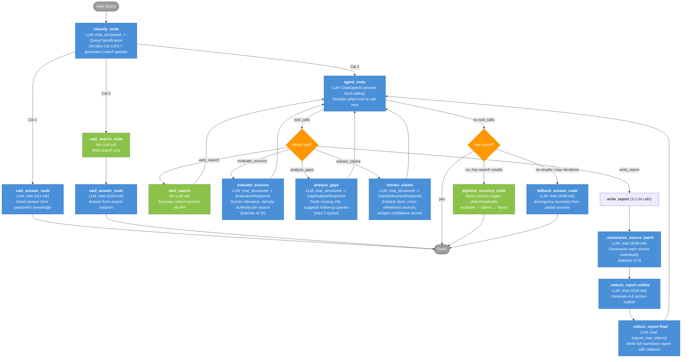

# Deep Research Agent — Implementation

How the agent is built: the LangGraph state machine, the five tools, where each
LLM call happens, and the supporting subsystems (dual-LLM routing, summarization,
caching, session isolation, metrics).

For deploying it, see [deployment.md](deployment.md). For configuration tables,
see the [README](../README.md#4-configuration).

---

## 1. Layout

```
src/
├── agent/
│   ├── graph.py            # LangGraph StateGraph: nodes, routers, build_graph()
│   ├── tools.py            # the 5 agent tools (@tool functions)
│   ├── tool_node.py        # ResearchToolNode — executes tools, merges state, emits progress
│   ├── llm.py              # ChatOpenAI factory for the tool-calling agent node
│   ├── prompts.py          # system prompts (classifier, agent, report, …)
│   └── state.py            # ResearchState TypedDict
├── db/                     # async SQLAlchemy models, repositories, session factory
├── search_providers/       # tavily.py, serper.py, composite.py (parallel fan-out)
├── middleware/auth.py      # X-API-Key middleware (no-op when API_KEYS is empty)
├── frontend/               # static web UI (mounted at /)
├── eval/                   # eval suites + dashboard.py (live metrics server)
├── tests/                  # unit tests for classification + graph routing
├── api.py                  # FastAPI app: REST + SSE, mounts the frontend
├── researcher.py           # pipeline orchestration helpers
├── search.py               # search coordination + content fetching
├── cache.py                # TTL search/content cache, SQLite-backed
├── extractive_summarizer.py# embedding-based page compression (MiniLM, CPU)
├── chunk_summarizer.py     # heading-aware chunking used by the summarizer
├── llm_summarizer.py       # optional LLM summarization path
├── llm_client.py           # OpenAI-compatible async client + module→slot routing
├── token_tracker.py        # per-run token/hardware accounting; writes RESULTS_DIR
├── models.py               # pydantic domain models
├── config.py               # Settings (pydantic-settings; env-var driven)
└── main.py                 # uvicorn entry point (host/port from Settings)
```

Only two files differ from upstream `frameworks.ai.deep-research`: both
`token_tracker.py` and `eval/dashboard.py` now resolve their metrics directory
from the `RESULTS_DIR` env var so writer and reader agree on the mounted volume
(upstream used CWD-relative paths and a hardcoded developer path).

---

## 2. Request lifecycle

```
POST /api/research
   ├─ create ResearchSession (uuid), persist to SQLite
   ├─ create an asyncio.Queue for this research_id           ← the SSE channel
   ├─ spawn the graph run as a background task
   └─ return {"research_id": …, "status": "pending"}         ← immediately

GET /api/research/{id}/stream
   └─ drains that queue as `data: {ProgressEvent}` SSE frames until the run
      pushes a sentinel None

GET /api/research/{id}
   └─ in-memory session if still active, else loaded from SQLite
```

Because the queues and the active-session dict live in the process, **a research
run is pinned to the pod that started it** — hence `replicaCount: 1`.

`ProgressEvent` (see `models.py`) carries far more than a percentage: the current
component name, incremental `thinking_chunk` tokens, per-step token counts, and
the hardware/model label each step actually used. The web UI renders all of it;
the example client filters the token-level chunks out.

---

## 3. The graph

A query does **not** always run the full pipeline. `classify_node` assigns one of
three categories and routes accordingly, which keeps trivial questions cheap.

| Category | Route | Cost |
|---|---|---|
| 1 — simple factual | `cat1_answer` — direct answer from parametric knowledge | 2 LLM calls |
| 2 — needs current facts, no synthesis | `cat2_search` → `cat2_answer` — search, then answer from snippets | 2 LLM calls + 1 search |
| 3 — genuine research | full ReAct agent loop | many |



### The five tools

| Tool | LLM calls | What it does | State it writes |
|---|---|---|---|
| `web_search` | 0 | Fans out the queries across every configured provider in parallel, deduplicates, fetches and (optionally) compresses page content | `search_results`, `search_count`, `search_queries_history` |
| `evaluate_sources` | 1 per batch of 10 | Scores each source on relevance / information density / authority; drops anything under `RELEVANCE_THRESHOLD` | `evaluated_sources` |
| `analyze_gaps` | 1 | Names what's still missing and proposes follow-up queries. Skipped entirely when `MAX_RESEARCH_CYCLES=1` | `search_queries_history` |
| `extract_claims` | 1 | Pulls factual claims, cross-references them across sources, assigns confidence | `claims` |
| `write_report` | 3 (map + outline + final) | Map-reduce synthesis: summarise each source, draft an outline, write the cited markdown | `report_markdown`, `citations` |

Tools are executed by `ResearchToolNode` (`agent/tool_node.py`) rather than
LangGraph's stock `ToolNode`, because it also has to:

1. **Merge state** — each tool returns JSON containing a `state_updates` block,
   which the node parses and folds into `ResearchState`.
2. **Emit progress** — a `step_start` event before and a `step_done` event after,
   with the tool's token counts and the hardware/model that served it.
3. **Absorb failures** — an exception becomes a `ToolMessage` describing the
   error, so the agent can adapt instead of the graph dying.

### Robustness

Small models misbehave in predictable ways, and the graph handles each case:

- **Text-shaped tool calls.** Some models emit a JSON tool call as message
  content instead of a real `tool_calls` field. `_try_parse_text_tool_calls()`
  (`agent/graph.py`) recovers those, including coercing argument types
  (`_fix_arg_types`).
- **Early exit.** If the agent stops calling tools while search results exist but
  no report does, `should_continue()` routes to `pipeline_recovery_node`, which
  runs evaluate → claims → report deterministically. **A cited report is always
  produced** for a Cat-3 query with sources.
- **Circuit breaker.** `AGENT_MAX_ITERATIONS` (default 15) caps the loop; on trip
  it goes to recovery when possible, otherwise `fallback_answer_node` writes an
  emergency summary from whatever partial sources exist.
- **Classification failure.** If `classify_node` raises, the query defaults to
  Cat 3 (full pipeline) — degrade toward more work, not less.

---

## 4. Dual-LLM routing

Every LLM call site names its module: `get_llm("extract_claims")`,
`get_llm("classify")`, and so on (`llm_client.py:486`). If that module name
appears in `SECONDARY_LLM_MODULES` *and* both `SECONDARY_LLM_BASE_URL` and
`SECONDARY_LLM_MODEL` are set, the call goes to the secondary slot; otherwise the
primary. The tool-calling agent node routes the same way through
`agent/llm.py`, keyed on the module name `agent`.

Routable modules: `classify`, `cat1_answer`, `cat2_answer`, `agent`,
`evaluate_sources`, `analyze_gaps`, `extract_claims`, `write_report`,
`decompose_query`, `synthesize_report`, `fallback_answer`.

Typical split — keep tool calling on the large model, push the structured
extraction work to a small one:

```
SECONDARY_LLM_BASE_URL=http://litellm.litellm.svc.cluster.local:4000/v1
SECONDARY_LLM_MODEL=<a smaller model registered in LiteLLM>
SECONDARY_LLM_MODULES=classify,analyze_gaps,extract_claims
```

Both slots can point at the same LiteLLM endpoint with different model names — this is a
*model* split, not an *endpoint* split, and neither slot deploys anything.

`LLM_HARDWARE` / `SECONDARY_LLM_HARDWARE` are cosmetic labels that flow into
progress events and the metrics dashboard so per-slot cost is visible. Leaving
`SECONDARY_LLM_MODULES` empty routes everything to the primary.

---

## 5. Page summarization

Raw web pages are far too long to feed to an LLM at 5+ sources per query. Before
a source reaches `evaluate_sources` or `write_report`, it is compressed:

1. `chunk_summarizer.py` splits the cleaned page (`clean_text.py`) into
   heading-aware chunks, sub-splitting anything over
   `EXTRACT_CHUNK_MAX_CHARS` (2000).
2. `extractive_summarizer.py` embeds sentences with `all-MiniLM-L6-v2`
   (sentence-transformers, CPU) and selects the most representative ones —
   default method `centroid`, blending query similarity with page-centroid
   similarity (`EXTRACT_QUERY_WEIGHT=0.5`) — up to `EXTRACT_BUDGET_MAP` (800)
   NLTK words per source, roughly 2000 LLM tokens.

This path is **not optional at import time**: `agent/tools.py` imports
`extractive_summarizer` at module scope, and that module imports `nltk` and
`sentence_transformers` and needs the `punkt_tab` tokenizer. Which is why the
image bakes both assets in and runs with `HF_HUB_OFFLINE=1` — the pod never
reaches out to HuggingFace. Setting `USE_EXTRACTIVE_SUMMARIZER=false` skips the
compression at runtime but does not remove the dependency.

`llm_summarizer.py` is an alternative that summarises with an LLM call instead
(`USE_LLM_SUMMARIZER=true`) — more faithful, considerably more expensive.

---

## 6. Search providers

`search_providers/` defines a small `SearchProvider` interface with `tavily.py`
and `serper.py` implementations, combined by `composite.py`, which queries every
configured provider **in parallel** and merges deduplicated results. Adding a
provider means implementing the interface and registering it there.

Tavily is required; Serper is a second opinion when a key is present. Provider
traffic (`api.tavily.com`, `google.serper.dev`) and source-page fetches leave the
cluster, while LiteLLM is reached in-cluster — hence the `NO_PROXY` default
listing `.svc` and the private ranges. The Helm chart sets only `NO_PROXY`; it
does **not** inject `http_proxy`/`https_proxy`, so in Kubernetes the pod needs
direct egress to the search providers (see the README troubleshooting table).
`agent/llm.py` builds its httpx client with `trust_env=False` and strips
`ALL_PROXY`/`all_proxy` before constructing `ChatOpenAI`, since langchain-openai
reads proxy env vars at init and rejects the `socks://` scheme outright.

---

## 7. Caching

Two `cachetools.TTLCache` layers in `cache.py`:

| Cache | Key | TTL | Size |
|---|---|---|---|
| Search results | normalised + hashed query | `SEARCH_CACHE_TTL_HOURS` (24 h) | `SEARCH_CACHE_MAX_ENTRIES` (500) |
| Page content | URL hash | 7 days | 1000 |

The search cache is **write-through to SQLite** (`persist_cache_entry`) and
**warmed from the DB on startup** (`load_cache_from_db`), so a pod restart
doesn't re-buy search results — provided the DB is on the PVC, which is the
default. `GET /api/system/cache-stats` reports both layers; `DELETE /api/cache`
clears both.

---

## 8. Session isolation and persistence

Each browser generates a `client_id` UUID into `localStorage` and sends it as
`X-Client-ID`. `GET /api/sessions` and `DELETE /api/sessions` are scoped by it,
so users on a shared deployment see only their own history. Non-browser callers
(the example clients, curl) send nothing and are treated as anonymous.

Everything durable lives under the mount at `/app/data`:

| Path | Contents |
|---|---|
| `/app/data/deep_research.db` | `DATABASE_URL` — sessions, reports, persisted search cache |
| `/app/data/results/live/*.json` | `RESULTS_DIR` — one metrics file per completed run |

---

## 9. Metrics and the eval dashboard

`token_tracker.py` accounts input/output tokens per LLM call, attributes them to a
module and a hardware label, and — after each completed run — writes
`RESULTS_DIR/<research_id>.json` with the query, category, status, elapsed time,
iteration count, input source (`ui` / `cli` / `api`), the per-slot config, and the
report itself.

`eval/dashboard.py` is a small stdlib HTTP server (port 8082) that watches that
directory and renders a table, charts, and full reports. It is a **second process
in the same container**, started by `startup.sh` only when
`EVAL_DASHBOARD_ENABLED=true`, and it reads the same `RESULTS_DIR` the tracker
writes. It serves its assets from absolute paths (`/vendor/...`, `/report/...`),
so a path-prefix route would break it — the chart gives it its own HTTPRoute on
`httpRoute.dashboardHost` (default `deep-research-agent-dashboard.<base_domain_name>`),
or port-forward 8082.

The offline eval suites (`eval/eval_10queries.py`,
`eval_research_queries.py`, `eval_tool_ordering.py`) ship in the image for
benchmarking a model/config combination; they are not wired into the deployment.

---

## 10. Container

Multi-stage build (`src/Dockerfile`):

- **builder** — installs `requirements.txt` into `/install` with
  `--extra-index-url https://download.pytorch.org/whl/cpu`, so torch is the
  CPU-only wheel. This blueprint hosts no models locally; the CUDA wheel would add
  ~1 GB for nothing.
- **runtime** — copies `/install` over, adds the app tree, creates the non-root
  `researcher` user (UID/GID 10001, for Pod Security `restricted`), and pre-downloads NLTK `punkt_tab` plus `all-MiniLM-L6-v2`
  into `/app/nltk_data` and `/app/hf_cache`.

`WORKDIR` is `/app` and must stay there: `api.py` mounts
`StaticFiles(directory="frontend")` by relative path. `HF_HUB_OFFLINE=1` makes any
accidental model download fail loudly at build time rather than silently at
runtime. The `HEALTHCHECK` and both Kubernetes probes hit `/health`, which is in
the auth middleware's public-path set and so works even with `API_KEYS` set.

Startup takes ~30–60 s: importing torch and loading the embedding model happens
before uvicorn accepts connections. The probes allow 45 s plus 6 failures and
Compose sets `start_period: 90s`.
